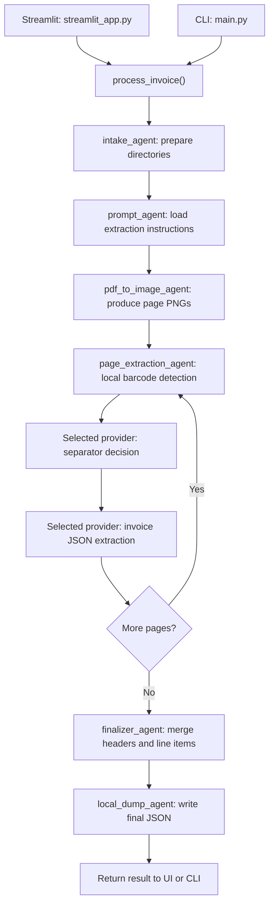

# Agentic AP Invoice Automation — Project Guide

This guide explains the current application from setup to output review, including its architecture, source files, provider settings, barcode handling, error behavior, and extension points. [README.md](README.md) provides the shorter quick start.

## 1. Purpose and scope

The project turns an Accounts Payable invoice supplied as a PDF or image into structured JSON. A Streamlit workspace lets a reviewer compare the rendered document with extracted header fields, line items, separator decisions, and page audit information. A command-line entry point runs the same extraction workflow.

The application currently supports three providers:

| Provider | Purpose | Credentials |
| --- | --- | --- |
| `grok` | Default provider; calls xAI for image-based separator detection and invoice extraction. | `XAI_API_KEY` |
| `oci` | Alternative provider; calls OCI Generative AI Inference. | OCI config profile, API signing key, compartment, endpoint, and model ID |
| `mock` | Exercises the local workflow without calling a model; produces empty invoice fields and line items. | None |

`grok` means xAI Grok. Groq is a different service and does not have an adapter in this repository. Selecting one provider does not automatically fall back to another.

The current application produces one consolidated invoice result per input file. It does not post invoices to an ERP, execute payments, persist results in a database, or provide an approval workflow. The review UI displays extracted values; it does not save corrections to them.

## 2. Architecture



[AgenticAPInvoiceProcessor](agent_workflow.py) builds a fixed, sequential LangGraph `StateGraph`. The “agents” are named workflow stages. The graph determines their order; the model does not choose the next stage or invoke arbitrary application tools.

`AgentState` carries the source path, output and work directories, prompt text, page-image paths, page results, and final result between stages. `PageResult` and `FinalInvoiceJson` are Pydantic models defined in [app_models.py](app_models.py).

### The six workflow stages

| Stage | Responsibility | Result |
| --- | --- | --- |
| `intake_agent` | Creates the run's working directory and the selected output directory. | Directories ready for processing |
| `prompt_agent` | Reads `PROMPT_FILE` as UTF-8. Relative paths are resolved from the current working directory. | Extraction instructions |
| `pdf_to_image_agent` | Renders every PDF page, or converts a supported image into one PNG. | Ordered page-image paths |
| `page_extraction_agent` | Processes pages in order, detects local barcodes, asks the selected model about separators, then extracts invoice JSON. | One page result per completed or recoverably failed page |
| `finalizer_agent` | Merges supported header fields, appends line items, and summarizes model-identified separators. | `FinalInvoiceJson` |
| `local_dump_agent` | Serializes the result as indented JSON. | `<source_stem>_ap_extraction.json` |

For each page that reaches both model operations, Grok or OCI receives two requests: one separator check and one invoice extraction. Pages are not processed concurrently.

## 3. Repository map

| File or directory | What it contains |
| --- | --- |
| [streamlit_app.py](streamlit_app.py) | Upload handling, provider controls, document viewer, extracted-field display, line-item grid, audit view, and JSON download |
| [main.py](main.py) | CLI arguments, configuration overrides, workflow invocation, and final JSON printing |
| [config.py](config.py) | Environment loading, `AppConfig`, numeric setting conversion, and application directory creation |
| [agent_workflow.py](agent_workflow.py) | LangGraph orchestration, per-page processing, final merge rules, and output writing |
| [app_models.py](app_models.py) | Workflow state, page/final result models, and supported header/line-item templates |
| [document_converter.py](document_converter.py) | PDF/image dispatch and single-image conversion |
| [grok_llm.py](grok_llm.py) | xAI Responses API adapter, configuration checks, response parsing, and access-error handling |
| [oci_llm.py](oci_llm.py) | `PageExtractor` interface, provider factory, mock implementation, OCI adapter, and shared image/JSON/separator helpers |
| [diagnose_oci.py](diagnose_oci.py) | OCI profile/key checks and a model-listing request for diagnosing access |
| [prompts/invoice_extraction_prompt.md](prompts/invoice_extraction_prompt.md) | Invoice field definitions, extraction instructions, and expected response structure |
| [barcode_pipeline/local_barcode.py](barcode_pipeline/local_barcode.py) | Local ZXing decoding, image variants, separator heuristics, and optional Tesseract fallback |
| [barcode_pipeline/models.py](barcode_pipeline/models.py) | Local barcode and standalone PDF-splitting result structures |
| [barcode_pipeline/pdf_utils.py](barcode_pipeline/pdf_utils.py) | PDF rendering, selected-page writing, and page-removal helpers |
| [barcode_pipeline/pipeline.py](barcode_pipeline/pipeline.py) | Separate local-barcode PDF splitting workflow; not invoked by the main invoice extractor |
| [barcode_pipeline/__init__.py](barcode_pipeline/__init__.py) | Barcode package exports |
| [tests/test_grok.py](tests/test_grok.py) | Provider/configuration checks, mocked Grok requests, failure cases, and a workflow integration test |
| [requirements.txt](requirements.txt) | Python dependency minimum versions |
| [.env.example](.env.example) | Shareable configuration template with a blank API key and placeholder OCI identifiers |
| [.gitignore](.gitignore) | Exclusions for credentials, virtual environments, inputs, outputs, and intermediate files |
| `.env` | Local runtime settings and secrets; excluded from Git |
| `inputs/` | Uploaded source files; created at runtime and excluded from Git |
| `.work/` | Rendered page images organized by run; excluded from Git |
| `outputs/` | Final local extraction JSON files; excluded from Git |

## 4. Installation and first run

Use Python 3.11 or later: the source uses `datetime.UTC`. Python 3.12 was used for the existing development environment. The dependency list contains minimum versions rather than a lock file.

From a PowerShell terminal:

```powershell
git clone https://github.com/Harsha9600/Agentic-AP_Automation.git
cd Agentic-AP_Automation
python -m venv .venv
.\.venv\Scripts\Activate.ps1
python -m pip install -r requirements.txt
if (-not (Test-Path .env)) { Copy-Item .env.example .env }
```

The repository is private, so cloning requires a GitHub account with access. Run the commands below from the repository root so relative prompt and storage paths resolve consistently.

For a first local smoke run, use a PDF or image of your own:

```powershell
python main.py "C:\path\sample-invoice.pdf" --provider mock
```

Mock mode verifies the processing path and creates an output artifact. Empty invoice fields in this mode are expected.

For real extraction, configure Grok or OCI as described below. The `pytesseract` Python package is a wrapper; the optional local OCR fallback also needs a separately installed Tesseract executable. Barcode decoding and model-based extraction can still run when that fallback is unavailable.

## 5. Configuration reference

`AppConfig.from_env()` loads dotenv settings and reads environment variables. Existing process environment variables take precedence over values loaded from `.env`. Restart the Streamlit process after changing provider settings or credentials in `.env` so previously loaded environment values are refreshed.

The CLI's `--provider` option and the UI's provider selection override `LLM_PROVIDER` for that run. The UI also overrides rendering DPI and model image size through its sliders.

### Application and image settings

| Variable | Code default | Meaning |
| --- | --- | --- |
| `LLM_PROVIDER` | `grok` | Select `grok`, `oci`, or `mock` |
| `APP_INPUT_DIR` | `inputs` | UI upload storage directory |
| `APP_OUTPUT_DIR` | `outputs` | Default final JSON directory |
| `APP_WORK_DIR` | `.work` | Parent directory for per-run page images |
| `PROMPT_FILE` | `prompts/invoice_extraction_prompt.md` | UTF-8 invoice extraction prompt |
| `PDF_RENDER_DPI` | `300` | Resolution used to render PDF pages locally |
| `IMAGE_MAX_SIDE` | `1800` | Maximum image dimension sent to a model, preserving aspect ratio |
| `TESSERACT_CMD` | `tesseract` in the barcode helper | Executable name or path for optional local OCR fallback |

Local PDF rendering uses PyMuPDF. Before either provider receives an image, a shared helper converts it to RGB, reduces it to fit `IMAGE_MAX_SIDE`, and encodes it as a JPEG data URL with quality 88. Local barcode detection uses the page image before this model-input resizing.

### Grok settings

```dotenv
LLM_PROVIDER=grok
XAI_API_KEY=
GROK_BASE_URL=https://api.x.ai/v1
GROK_MODEL_ID=grok-4.7
GROK_MAX_TOKENS=8000
GROK_TEMPERATURE=0
GROK_TIMEOUT_SECONDS=180
GROK_REASONING_EFFORT=low
```

Set `XAI_API_KEY` locally using a key from the [xAI Console](https://console.x.ai/). The model ID above is this project's configured default, not an automatic model-discovery result. Your account must have access to the selected image-capable model.

| Variable | Meaning |
| --- | --- |
| `XAI_API_KEY` | Required bearer credential |
| `GROK_BASE_URL` | HTTPS API base URL; the adapter appends `/responses` |
| `GROK_MODEL_ID` | Model used for both separator and invoice operations |
| `GROK_MAX_TOKENS` | Invoice response token budget; the separator call uses the smaller of this value and 2,000 |
| `GROK_TEMPERATURE` | Requested sampling temperature, validated between 0 and 2 |
| `GROK_TIMEOUT_SECONDS` | Timeout passed to each HTTP request; must be positive |
| `GROK_REASONING_EFFORT` | `low`, `medium`, `high`, or `xhigh`; blank omits the parameter |

The adapter uses Python's standard HTTP library, so no xAI or OpenAI SDK is required. It requests JSON-object output, disables streaming, and sends `store: false` to disable API response-history storage. It does not configure a strict invoice JSON schema on the server. The returned JSON is parsed and its main invoice containers are checked locally.

Grok is a paid API; creating a key is not a promise of free inference. Consult the [provider's API information](https://x.ai/api) for current account and billing terms. Groq keys cannot be substituted for `XAI_API_KEY`.

### OCI settings

Keep the OCI configuration alongside Grok settings to switch providers without reconstructing it:

```dotenv
OCI_CONFIG_FILE=~/.oci/config
OCI_PROFILE=DEFAULT
OCI_COMPARTMENT_ID=ocid1.compartment.oc1..replace_me
OCI_GENAI_ENDPOINT=https://inference.generativeai.us-chicago-1.oci.oraclecloud.com
OCI_GENAI_MODEL_ID=ocid1.generativeaimodel.oc1.region.replace_me
OCI_GENAI_MAX_TOKENS=4000
OCI_GENAI_TEMPERATURE=0
```

| Variable | Meaning |
| --- | --- |
| `OCI_CONFIG_FILE` | OCI SDK credentials file; the code default is the user's `.oci/config` path |
| `OCI_PROFILE` | Profile name, defaulting to `DEFAULT` |
| `OCI_COMPARTMENT_ID` | Compartment used for model inference |
| `OCI_GENAI_ENDPOINT` | Regional Generative AI Inference endpoint |
| `OCI_GENAI_MODEL_ID` | Image-capable model identifier available in that environment |
| `OCI_GENAI_MAX_TOKENS` | Invoice extraction output budget; default 4,000 |
| `OCI_GENAI_TEMPERATURE` | Requested sampling temperature; default 0 |

The SDK profile includes fields such as `user`, `fingerprint`, `tenancy`, `region`, and `key_file`. Use one consistent set per profile; duplicate keys inside the same section cause configuration parsing to fail. Keep separate accounts in separate named profiles.

The adapter validates the SDK configuration, verifies that the signing-key file exists, constructs an API-key signer, and uses on-demand serving with JSON-object responses. Its separator request has a 700-token budget. Grok does not load the OCI credentials file when selected.

Run the diagnostic only when checking OCI:

```powershell
python diagnose_oci.py
```

This script checks profile and key configuration, then calls the Generative AI control-plane endpoint to list models. A successful model list does not prove that an image inference request will succeed.

## 6. Using the application

### Streamlit workspace

```powershell
python -m streamlit run streamlit_app.py
```

Open the address reported by Streamlit, normally `http://localhost:8501`.

1. Select `grok`, `oci`, or `mock` in the sidebar.
2. Adjust PDF rendering DPI and maximum model image dimension if needed.
3. Upload one supported PDF or image.
4. Click **Extract Invoice JSON**.
5. Compare the rendered pages with the header values and line-item table.
6. Expand **Page audit and final JSON** to inspect per-page decisions, errors, parsed model JSON, or download the result.

Supported extensions are `.pdf`, `.png`, `.jpg`, `.jpeg`, `.tif`, `.tiff`, `.bmp`, and `.webp`. PDF inputs render all pages. Image inputs become a single page; the converter does not iterate all frames of a multipage TIFF.

The UI stores uploads as `inputs/<uuid>_<original_filename>`. Within a session it reuses an existing upload when the filename and size match. The latest result is stored in Streamlit session state. Uploads and generated files also remain on disk.

### Command line

```powershell
# Uses LLM_PROVIDER from the current environment.
python main.py "C:\path\invoice.pdf"

# Explicit provider selection.
python main.py "C:\path\invoice.pdf" --provider grok
python main.py "C:\path\invoice.pdf" --provider oci
python main.py "C:\path\invoice.pdf" --provider mock

# Explicit output directory.
python main.py "C:\path\invoice.pdf" --provider grok --output-dir "C:\path\results"
```

The CLI prints the output path and serialized final JSON. Errors classified as `FatalLlmConfigurationError` produce a provider-specific message and exit code 2. Other uncaught failures can produce a traceback. Recoverable per-page errors can still result in an output file and a normal CLI return, so consumers must inspect `pageAudit`.

## 7. Barcode and separator behavior

There are two distinct decisions:

| Decision | Where to inspect it | Meaning |
| --- | --- | --- |
| Local detection | `pageAudit[].barcode_detection` | What the local decoder and separator heuristics found; may include QR codes or other barcode types |
| Model separator decision | `pageAudit[].document_separator_detection` | Whether the model identified a document-separator sheet with a Code 39 separator |

The local detector uses ZXing on the original image and retry variants including grayscale, enhanced contrast, and cropped regions. Visual separator heuristics consider page layout. If a candidate separator cannot be decoded, an optional Tesseract fallback tries its printed human-readable value.

The model receives local barcode results as reference. Its separator instructions exclude payment QR codes, banking barcodes, and barcodes at the bottom of normal invoice pages. The final `barcodeDetails` summarizes these model separator decisions, not every locally detected barcode.

Consequently, `barcodeDetails.has_barcode` may be false while a page's local `barcode_detection.has_barcode` is true. These fields have different scopes.

**The main extraction graph does not split the uploaded document or skip separator pages.** It sends every rendered page through extraction and merges results into one invoice. A file containing several different invoices can therefore combine unrelated data.

The separate `barcode_pipeline.pipeline.process_pdf()` function can detect separators locally and call `split_invoices()` to write PDFs for the pages following each separator until the next one. That utility is not connected to the Streamlit or CLI invoice workflow. If it finds no separators, it writes no split invoice documents; pages before the first separator are not included in its split outputs.

## 8. Output JSON and merge rules

Final files are written to:

```text
<output_dir>/<source_stem>_ap_extraction.json
```

Rendered pages are retained under:

```text
<work_dir>/<source_stem>_<UTC timestamp>/pages/page_001.png
```

The UI's UUID upload prefix becomes part of the source stem and therefore the JSON filename. Processing the same source stem into the same output directory overwrites its previous final JSON.

### Top-level sections

| Field | Contents |
| --- | --- |
| `source_file` | Resolved source path |
| `header` | The supported invoice-header template populated from page results |
| `lineItems.lineItem` | Ordered list of supported line-item fields |
| `barcodeDetails` | Scope, separator decision source, separator pages/values, and detailed separator records |
| `pageAudit` | Page number, image path, local barcodes, model separator result, parsed invoice JSON, and optional extraction error |
| `processing` | UTC processing time, page count, provider, model ID, and format/decision metadata |

### Header fields

| Group | Field names |
| --- | --- |
| Vendor | `VENDOR_NAME`, `ADDRESS_LINE1`, `ADDRESS_LINE2`, `VENDOR_CITY`, `VENDOR_STATE`, `VENDOR_COUNTRY_CODE`, `VENDOR_POSTAL_CODE` |
| Customer | `CUSTOMER_NAME`, `CUSTOMER_ADDRESS`, `CUSTOMER_CITY` |
| Bill-to | `BILL_TO_COMPANY_NAME`, `BILL_TO_ADDRESS`, `BILL_TO_COUNTRY_CODE`, `BILL_TO_CITY` |
| Invoice identity | `INVOICE_NUMBER`, `INVOICE_DATE`, `INVOICE_TYPE`, `DOCUMENT_TYPE`, `LANGUAGE_CODE`, `IDENTIFICATION_NUMBER` |
| Commercial details | `PAYMENT_TERMS`, `PO_NUMBER`, `CURRENCY_CODE`, `INVOICE_AMOUNT`, `TAX_AMOUNT`, `SUBTOTAL` |

### Line-item fields

Each final line contains `LINE_TYPE`, `LINE_AMOUNT`, `ITEM_CODE`, `LINE_DESCRIPTION`, `QUANTITY`, `UNIT_OF_MEASURE`, `UNIT_PRICE`, `LINE_TAX_AMOUNT`, `TAX_RATE`, and `LINE_NUMBER`.

### How merging works

- Header values are filled from pages in order. The first nonempty value generally wins. The default placeholders `NON-PO`, `STANDARD`, and `UNK` can be replaced by later values for their respective fields.
- A populated `PO_NUMBER` forces final `DOCUMENT_TYPE` to `PO`. Missing document, invoice, and language types default to `NON-PO`, `STANDARD`, and `UNK`.
- Line items are appended in page order, restricted to known template keys, and renumbered from 1 across the complete document. Empty records whose only content is a line number are dropped.
- Separator values are deduplicated in `barcode_values`; detailed separator records remain associated with their pages.
- Unsupported model fields can remain in `pageAudit[].llm_json` but are not automatically promoted into final header or line-item templates.

Apart from these rules, values are largely preserved as supplied by the model. Amounts may be numbers or strings. The finalizer does not independently reconcile totals, deduplicate repeated line items, or validate the semantic accuracy of dates, currencies, or tax IDs. Instructions in the extraction prompt request these checks from the model; they are not deterministic application validations.

### Illustrative JSON excerpt

This fictional example omits the other template fields and parts of the per-page model JSON for readability. It is not taken from a real invoice.

```json
{
  "source_file": "C:/example/invoice.pdf",
  "header": {
    "VENDOR_NAME": "Example Supplier",
    "INVOICE_NUMBER": "INV-001",
    "DOCUMENT_TYPE": "NON-PO",
    "INVOICE_TYPE": "STANDARD",
    "INVOICE_DATE": "2026-10-01",
    "SUBTOTAL": 100,
    "TAX_AMOUNT": 20,
    "INVOICE_AMOUNT": 120,
    "CURRENCY_CODE": "USD",
    "LANGUAGE_CODE": "EN"
  },
  "lineItems": {
    "lineItem": [
      {
        "LINE_NUMBER": 1,
        "LINE_TYPE": "Item",
        "LINE_DESCRIPTION": "Example service",
        "QUANTITY": 2,
        "UNIT_PRICE": 50,
        "LINE_AMOUNT": 100,
        "LINE_TAX_AMOUNT": 20,
        "TAX_RATE": 20
      }
    ]
  },
  "barcodeDetails": {
    "scope": "document_separator_code_39_only",
    "decision_source": "llm_vision",
    "has_barcode": false,
    "barcode_pages": [],
    "barcode_values": [],
    "barcodes": []
  },
  "pageAudit": [
    {
      "page_number": 1,
      "image_path": "C:/example/work/pages/page_001.png",
      "barcode_detection": {
        "has_barcode": false,
        "is_separator_page": false,
        "barcodes": []
      },
      "document_separator_detection": {
        "page_number": 1,
        "is_document_separator": false,
        "barcode_type": null,
        "barcode_value": null,
        "source": "grok_llm_vision"
      },
      "llm_json": {
        "header": {"INVOICE_NUMBER": "INV-001"},
        "lineItems": {"lineItem": []}
      },
      "extraction_error": null
    }
  ],
  "processing": {
    "processed_at_utc": "2026-10-01T12:00:00+00:00",
    "page_count": 1,
    "all_pages_considered": true,
    "llm_provider": "grok",
    "model_id": "grok-4.7",
    "local_dump_format": "json",
    "separator_barcode_decision_source": "llm_vision"
  }
}
```

## 9. Failures and troubleshooting

An output file is evidence that finalization ran, not that every page was successfully extracted. Inspect `pageAudit[].extraction_error` and the extracted values before accepting a result. `processing.all_pages_considered` is implemented as “at least one page result exists”; it is not an extraction-success flag.

Within the model-operation block, `FatalLlmConfigurationError` stops the entire graph before its final dump. Other exceptions become page audit errors and processing continues. Local barcode detection runs before that block, so an exception from the local detector can stop the run directly.

| Symptom | Explanation and next step |
| --- | --- |
| `XAI_API_KEY is required` | Populate the key in the local `.env` and restart the app. Grok validates it before starting the graph. |
| Grok HTTP 401 | Check the xAI key. |
| Grok HTTP 402 or 403 | Check API credits, account/model access, and permissions. |
| Grok HTTP 404 | Check `GROK_BASE_URL` and the configured model ID. |
| Grok HTTP 400 or 422 | Check image capability and generation settings for the chosen model. |
| Grok HTTP 429 | The adapter stops the run; check rate/usage limits and account credits before retrying. |
| Grok response did not complete | Check the output budget, including room for model reasoning, and retry after adjusting settings if appropriate. |
| Grok cannot connect or times out | Check network/proxy access, the API URL, and `GROK_TIMEOUT_SECONDS`. |
| OCI `DuplicateOptionError` | Remove duplicate credential keys from the selected SDK config section, or separate accounts into named profiles. |
| OCI key file missing | Correct `key_file` in the selected OCI profile and verify its local path. |
| OCI 401/403/404 | Check authentication, permissions, compartment, regional endpoint, and model availability; the adapter treats these as fatal setup errors. |
| Empty final fields or no line items | Check the selected provider, source readability, prompt, model responses, and per-page errors. Empty values are expected in mock mode. |
| QR decoded locally but no final separator | This can be correct: final barcode details cover document-separator Code 39 decisions. |
| Tesseract unavailable | Install/configure the executable if the optional printed-text fallback is needed. It is not the invoice extraction engine. |
| PDF/image or prompt not found | Check the input and `PROMPT_FILE` paths; start the application from the repository root. |
| Streamlit `components.html` deprecation message | The current viewer still uses `st.components.v1.html`. This UI warning is separate from model authentication or extraction failures. |

Some OCI setup exceptions, including SDK config-file parsing errors, are not wrapped as `FatalLlmConfigurationError` and can therefore appear as recoverable page errors. A timeout, server error, malformed JSON, refusal, or incorrect invoice response shape can also lead to an error recorded for that page.

The Grok adapter has no automatic request retry loop. The shared code does not implement a cross-provider retry or fallback policy. If an earlier output file exists and a later run aborts before writing, the earlier file can remain on disk.

## 10. Data handling and operating limits

Uploaded originals, rendered page images, and final JSON are stored locally. Grok and OCI also receive page images and relevant prompt/barcode content when selected. In mock mode, the workflow makes no model API calls.

`.gitignore` excludes `.env` and its local variants, private-key file patterns, `.oci/`, `.aws/`, the virtual environment, input/output directories, work files, and caches. `.env.example` is deliberately tracked. Do not put real credentials or real invoice examples into documentation or that template.

The source logs locally decoded barcode values, which may themselves contain invoice data. Treat application logs as potentially sensitive along with the source and output files. The application has no automatic retention cleanup.

Other current limits:

- There is no built-in application authentication or authorization layer.
- There is no main-workflow multi-invoice grouping, output-per-separator handling, or line-item deduplication.
- Each extraction call sees its own page plus instructions and separator metadata; previous pages are not supplied as conversation context.
- There is no deterministic financial reconciliation or quality-score gate before writing JSON.
- There is no automatic model discovery, provider fallback, or persistent usage/cost accounting in the final result.

## 11. Tests and validation

Run the existing suite from the repository root:

```powershell
python -m pytest tests -q
```

The tests cover default/overridden environment settings, preservation of provider selection, invalid Grok settings, image-bearing requests, response validation, Code 39 versus QR behavior, access failures, and a mocked Grok workflow through final output writing.

They replace the HTTP transport with fake responses and require no real xAI key or paid model calls. They validate the integration contract and selected failure behavior; they do not establish real-world invoice accuracy or live OCI access.

For a model or prompt change, compare representative invoices with their `pageAudit` entries and final values. Use a small sample first because increasing document pages creates additional model requests.

## 12. Maintaining and extending the project

| Change | Files to start with | What else must stay aligned |
| --- | --- | --- |
| Change extraction rules | `prompts/invoice_extraction_prompt.md` | Expected field names and output structure |
| Add a header or line-item field | `app_models.py` | Prompt, merge rules, UI display, and tests; unsupported fields are otherwise dropped from the final templates |
| Add a model provider | `oci_llm.py` factory/interface and a new adapter | `config.py`, `.env.example`, UI provider choices, CLI choices, and provider tests |
| Change separator policy | Shared separator prompt/normalizer in `oci_llm.py` and local logic in `barcode_pipeline/local_barcode.py` | Final barcode scope and page-audit interpretation |
| Implement multi-invoice extraction | `agent_workflow.py` | Grouping semantics, per-invoice finalization/output, separator handling, and UI review |
| Add deterministic financial checks | `agent_workflow.py` finalization or a dedicated validation stage | Error/status representation and UI/consumer behavior |

The `PageExtractor` contract requires `provider_name`, `model_id`, `detect_document_separator_barcode()`, and `extract_page()`. A custom extractor can also be injected into `AgenticAPInvoiceProcessor(config, page_extractor=...)` for testing or experimentation.

### GitHub workflow

The project's remote is [Harsha9600/Agentic-AP_Automation](https://github.com/Harsha9600/Agentic-AP_Automation), with `main` as the configured branch. Review files before each push:

```powershell
git status
git diff
git add <specific-source-or-documentation-files>
git diff --cached
git commit -m "Describe the change"
git push origin main
```

Keep local credentials, invoice originals, output JSON, and rendered pages outside commits. The repository can be cloned elsewhere, but each environment needs its own `.env`, credentials, installed dependencies, and any optional Tesseract configuration.
